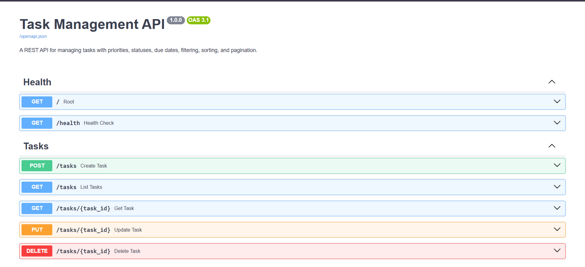
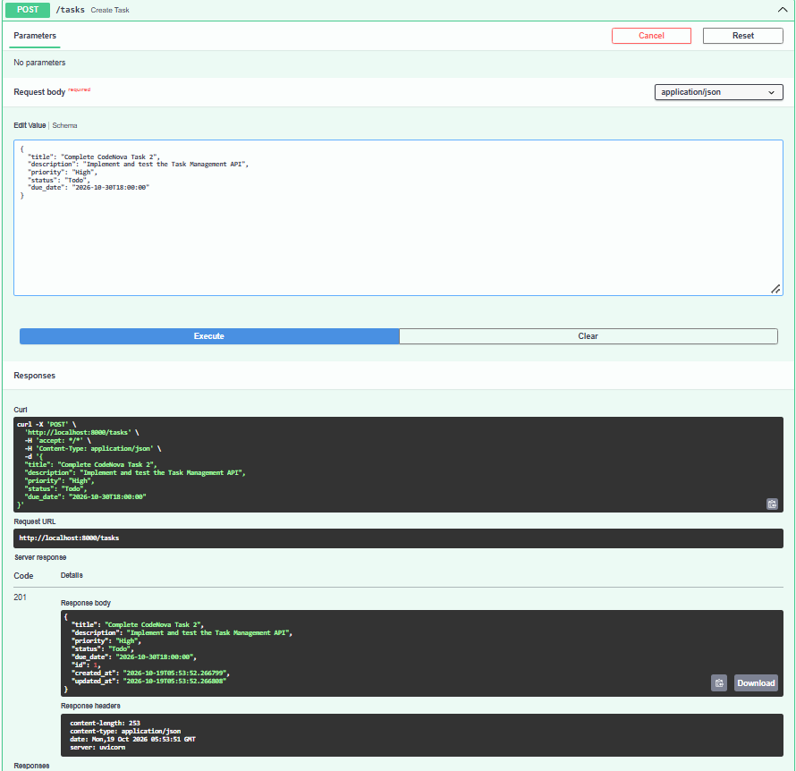
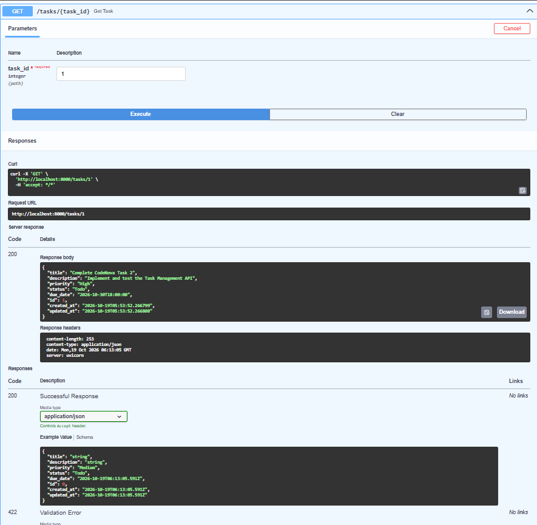
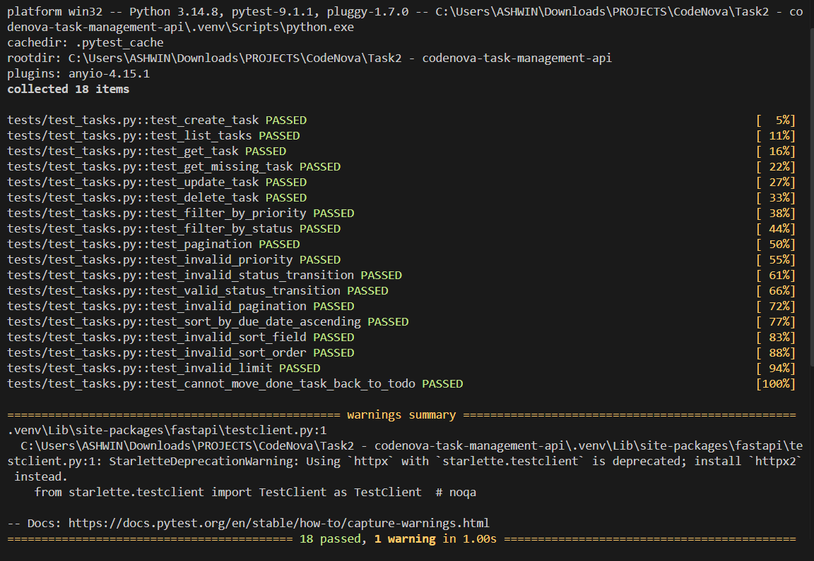

# Task Management API

A RESTful Task Management API developed using Python, FastAPI, SQLAlchemy, and SQLite.

## Features

- Create, retrieve, update, and delete tasks.
- Set task priority: Low, Medium, or High.
- Track task status: Todo, In Progress, or Done.
- Store optional descriptions and due dates.
- Filter tasks by status and priority.
- Sort tasks by creation date or due date.
- Paginate task listings.
- Validate request data and return meaningful HTTP errors.
- Enforce task status lifecycle transitions.
- Persist task records in SQLite.
- Initialize the database and insert sample tasks.
- Test API functionality using Pytest.

## Tech Stack

- Python
- FastAPI
- SQLAlchemy
- SQLite
- Pydantic
- Pytest
- HTTPX

## Project Structure

```text
app/
  controllers/
  models/
  routers/
  schemas/
  services/
  database.py
  main.py

scripts/
  init_db.py
  seed_db.py

tests/
  conftest.py
  test_tasks.py

data/
requirements.txt
.gitignore
README.md
```

## Installation

### 1. Clone the repository

```bash
git clone https://github.com/Ashwin-2008/Task2-codenova-task-management-api.git
cd Task2-codenova-task-management-api
```

### 2. Create a virtual environment

Windows PowerShell:

```powershell
python -m venv .venv
.\.venv\Scripts\Activate.ps1
```

### 3. Install dependencies

```bash
python -m pip install -r requirements.txt
```

### 4. Initialize the database

```bash
python -m scripts.init_db
```

### 5. Insert sample tasks

```bash
python -m scripts.seed_db
```

### 6. Start the server

```bash
python -m uvicorn app.main:app --reload
```

## API Documentation

Once the server is running:

- Interactive Swagger documentation: `http://127.0.0.1:8000/docs`
- Health check: `http://127.0.0.1:8000/health`

## API Endpoints

| Method | Endpoint | Description |
|---|---|---|
| POST | `/tasks` | Create a task |
| GET | `/tasks` | List tasks |
| GET | `/tasks/{task_id}` | Retrieve a task |
| PUT | `/tasks/{task_id}` | Update a task |
| DELETE | `/tasks/{task_id}` | Delete a task |

## Filtering, Sorting, and Pagination

Example:

```http
GET /tasks?status=Todo&priority=High&page=1&limit=5
```

Sort by due date, earliest first:

```http
GET /tasks?sort_by=due_date&order=asc&page=1&limit=10
```

Supported query parameters:

- `status`: Todo, In Progress, Done
- `priority`: Low, Medium, High
- `sort_by`: created_at, due_date
- `order`: asc, desc
- `page`: Page number, starting at 1
- `limit`: Results per page, between 1 and 100

List responses include pagination metadata such as total items, current page, limit, and total pages.

## Example Task Request

```json
{
  "title": "Complete CodeNova Task 2",
  "description": "Implement the Task Management API",
  "priority": "High",
  "status": "Todo",
  "due_date": "2026-10-30T18:00:00"
}
```

## Testing

Run the automated test suite:

```bash
python -m pytest -v
```

The current test suite contains 13 passing tests covering task CRUD operations, filtering, pagination, validation, and status transitions.

## Database

The application uses SQLite for persistent storage. The database file is generated locally at `data/tasks.db`.

## Screenshots

### API Documentation


### Create Task


### Task Listing and Pagination


### Automated Tests


## License

This project was created for educational purposes as part of the CodeNova Backend Development Internship.
